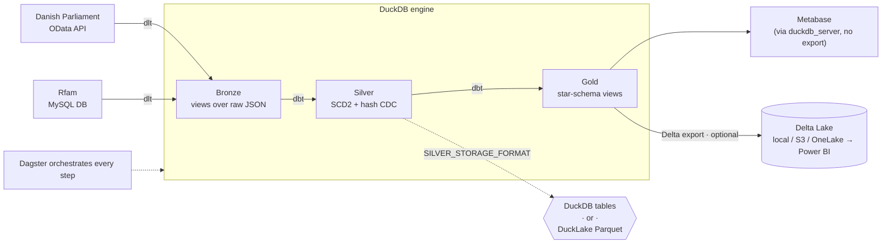
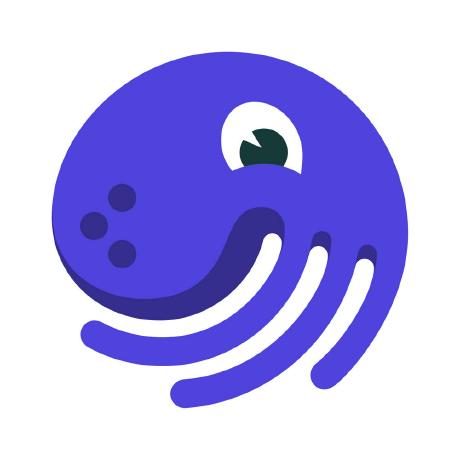
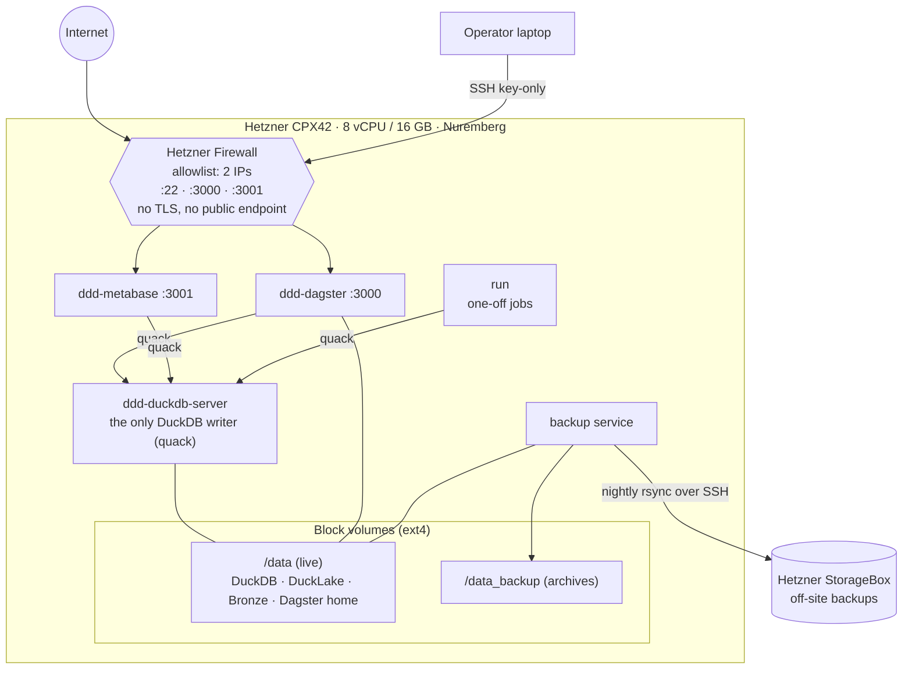

<!--
Speaker notes are in HTML comments like this one.
About 20 content slides at roughly 2 minutes each, plus 5 minutes for questions.
The audience knows the basics (views, SCD2, orchestration); focus on how this
project applies them and why.
-->

# A serious LakeHouse on a seriously tight budget

### Bronze → Silver → Gold with open data and free tools

*Danish Parliament data, RNA families, and DuckDB as the one query engine*

<!--
Opening. This is a reference project, not a product. The talk walks through the
design decisions: extraction, change capture, storage, orchestration, backups,
and what it costs to run.
-->

---

## Why this project

- A data platform that runs **on a laptop at no cost**, and still covers CDC, history, orchestration and backups.
- One machine, no Spark cluster.
- Everything is open source. The only optional paid component is the Microsoft Fabric OneLake export target.
- It is a learning project: the talk covers the decisions and the problems that came up along the way.

<!--
The constraint (one machine, no budget) determines most of the choices that
follow.
-->

---

## Two data sources

Two public sources with different shapes:

| | Danish Parliament (Folketing) | Rfam (EBI) |
| --- | --- | --- |
| What | MPs, meetings, cases, votes | RNA families, genomes, clans |
| Where | `oda.ft.dk` OData REST API | public MySQL database at EBI |
| Size | 18 entities | 7 tables |
| Why | relational data with change history | a SQL source with different keys and columns |

- Both are public: no API key or data agreement needed.
- Two sources with different keys and extraction modes show that the pipeline is not tied to one source.

<!--
Rfam has nothing to do with parliament data; it was chosen because it is a
different kind of source (SQL instead of REST, different primary keys and date
columns).
-->

---

## The stack



- **Extract:** dlt · **Transform:** dbt + DuckDB · **Orchestrate:** Dagster · **Export:** DuckDB reads, deltalake writes · **BI:** Metabase (through the DuckDB server).
- **dlt** is a Python extract-load library; **Dagster** is the orchestrator, comparable to SQL Agent or ADF but defined in code.

<p align="center">
  &nbsp;&nbsp;&nbsp;
  &nbsp;&nbsp;&nbsp;
  &nbsp;&nbsp;&nbsp;
  &nbsp;&nbsp;&nbsp;
  &nbsp;&nbsp;&nbsp;
  &nbsp;&nbsp;&nbsp;
  
</p>

<!--
Two points: DuckDB is the engine for every layer, and Silver has a switchable
storage format (covered later). The dotted edges are optional: the storage
format choice and the export. Solid edges run on every pipeline run.
-->

---

## The medallion layers

- **Bronze**: raw data, unchanged and queryable. JSON as it was extracted.
- **Silver**: **full history** (SCD Type 2). Hardly cleaned and not enriched, by design.
- **Gold**: for consumers. English names, surrogate keys, star schema.

Silver does not clean or enrich the data. Its job is to record **what changed and when**, without losing anything: hash-based CDC, SCD Type 2, and a load that can be re-run safely.

<!--
In many projects Silver means "cleaned and conformed". Here Silver only
historises: every version of every row is kept. Silver gets three slides because
capturing change correctly and repeatably is where most of the logic is.
-->

---

## Extraction with dlt

- One engine, two pipeline types: `api_to_file` for OData, `sql_to_file` for MySQL.
- Each entity is declared **incremental** or **full extract**:
  - DDD: 6 incremental (filtered on `opdateringsdato`), 12 full extracts.
  - Rfam: 2 incremental (`updated`), 5 full extracts.
- No stored cursor: incremental entities reload a **lookback window** (31 days for DDD, 365 for Rfam). The overlap is harmless because Silver's hash comparison skips unchanged rows. Output is **timestamped NDJSON** (`{entity}_{YYYYMMDD_HHMMSS}.json`).
- `ThreadPoolExecutor(max_workers=4)`: extraction is I/O-bound, so threads are sufficient.

<!--
Incremental versus full extract is configuration, declared once per entity in
configuration_variables.py. There is no stored state: the date filter is
"today minus N days", so a failed run needs no repair and a backfill is a run
with an earlier date. Dates are validated as YYYY-MM-DD before they reach the
OData filter, and the MySQL filter is a bound parameter.
-->

---

## Bronze: views over files

- 28 views: one generated view per entity, `read_json_auto()` over its folder,
  and three utility views.
- No data is copied: Bronze views read the files directly.

```sql
-- simplified; one view per entity
SELECT *, '<filename>' AS LKHS_filename
FROM read_json_auto('.../Bronze/DDD/aktoer/*.json')
```

<!--
Bronze costs very little because DuckDB reads JSON natively: no staging tables
and no copy step. Parquet would also work; NDJSON is used because it is close to
what the API returns.
-->

---

## Silver, part 1: detecting change with a hash

**Hash each new row and compare it with the key's latest version in Silver.** This does not depend on the source's update timestamp and avoids a column-by-column comparison.

- SHA-256 over the *business* columns only. Tracking columns (insert time, file name) are excluded; otherwise every row would look changed on every run.
- **Silver is the state.** A run reads only the Bronze files newer than the model's bookmark; processed files move to an archive.

```sql
-- simplified; the real hash uses a configurable delimiter and NULL token
with new_rows as (                      -- 1) hash the new files' business columns
    select id, LKHS_filename, sha256(concat_ws('|', navn, parti, rolle)) as hash
    from   bronze_ddd_aktoer
    where  LKHS_filename > '<bookmark>'
),
state as (                              -- 2) each key's latest version in Silver
    select id, sha256(concat_ws('|', navn, parti, rolle)) as hash
    from   silver_ddd_aktoer
    qualify row_number() over (partition by id order by LKHS_date_valid_from desc) = 1
)
select n.*,
       case when s.id is null      then 'I'     -- new key      -> insert
            when n.hash <> s.hash  then 'U'     -- hash changed -> update
       end as LKHS_cdc_operation                -- (deletes: a separate step)
from   new_rows n left join state s using (id);
```

- **Independent of batch size:** with several new files, each file is compared with the one before it, so five files in one run give the same rows as five runs.

<!--
Excluding the tracking columns from the hash is required; without it every row
changes on every run. The project first rebuilt Silver from all Bronze files on
every run; that was the cleaner design, but its cost grew with every day's files
(ADR-13). Silver now holds the state, so a run costs what its new files cost, and
the archive keeps every extraction for a replay. A run stops instead of writing
doubtful data: on a probable mass delete, a late file or a type change.
-->

---

## Silver, part 2: SCD Type 2 and current-version views

- Every change is **appended**; nothing is overwritten. Silver keeps the full history.
- Tracking columns, all prefixed `LKHS_`:
  - `LKHS_date_valid_from` · `LKHS_cdc_operation` (I/U/D) · `LKHS_hash_value`
- A `_cv` ("current version") view per table returns only the latest version of each row, so consumers that do not need history can ignore it.

> The hash-based CDC and SCD Type 2 approach is based on **Roelant Vos**'s work on data-warehouse automation and historisation.

<!--
The LKHS_ prefix separates system columns from business columns. The _cv views
mean nobody has to write the "filter to current version" logic by hand. 50
Silver models = 25 history tables + 25 _cv views. Roelant Vos's writing on
data-warehouse automation (content hash, load metadata, SCD2) is the source of
the approach and a good reference for the Data Vault background.
-->

---

## Silver, part 3: generated models

- Bronze and Silver models are **generated** from one Python file (`configuration_variables.py`).
- That file is the single source of truth: entity lists, primary keys, SQL templates.
- Adding an entity means editing the lists and regenerating. The macros contain the CDC logic.
- Import-time checks and tests keep the lists consistent (counts, subsets, no duplicates), so a missing entry fails at import or in CI.

```python
# add an Rfam table: update three lists/dicts, then
python -m ddd_python.ddd_dbt.generate_dbt_models
```

<!--
With 50+ Silver models, writing them by hand would be error-prone and
inconsistent. The generator and 16 dbt macros keep the CDC logic in one place.
The configuration tests catch a key added to one list but not to another.
-->

---

## Gold: the star schema

- 19 views: star-schema facts and dimensions, `_cv` current-version views, and a date dimension.
- English names (`silver_ddd_aktoer` → `actor`), a surrogate key per version (SCD2 dimensions).
- Surrogate keys are cast from **UBIGINT to signed BIGINT**, because Power BI does not accept unsigned 64-bit integers.
- Written by hand: the star schema needs modelling decisions. Only the `_cv` views are generated.

<!--
The BIGINT cast is one macro (cast_hash_to_bigint). Bronze and Silver are
generated; Gold is not, because the joins and naming are modelling decisions.
-->

---

## Orchestration with Dagster

- Software-defined **assets**, created by factory functions (one factory call per entity).
- Jobs: incremental, full extract, full pipeline, export, DuckLake cleanup.
- Two daily schedules (06:00 and 08:00, Europe/Copenhagen), **disabled by default**, so a new install does not call the public APIs until someone enables them.
- Run-status sensors fire on every job's success and failure: they write a summary record and send an **ntfy.sh** notification. Notifications are opt-in via `NTFY_TOPIC` in `.env`.

<!--
The asset factories follow the same idea as the generated dbt models: define the
shape once, create one per entity. Both sensors cover all jobs and send nothing
when NTFY_TOPIC is not set.
-->

---

## DuckDB's single writer

DuckDB allows **one writing process** per database file. The orchestration accounts for that:

- **dbt jobs use `in_process_executor`.** Everything that writes the database runs in one process, one step at a time.
- **Extraction and export use `multiprocess_executor` (max 4).** They write files, not the database, so they can run in parallel.
- **`duckdb_server` owns the database file; Dagster, dbt and Metabase are its quack clients**, so nothing is stopped for a run.
- **Tools such as DBeaver connect through the quack server too**, instead of opening the file.

<!--
This is a property of the engine, not something that shaped the whole design.
Writers (dbt) run in one process; extraction and export run in parallel; readers
(Metabase, people) stay connected, because they reach the file through the
server too.
-->

---

## Switchable Silver storage: DuckDB or DuckLake

One environment variable, `SILVER_STORAGE_FORMAT`, selects where Silver is stored:

| | `duckdb` (default) | `ducklake` |
| --- | --- | --- |
| Silver lives in | the `.duckdb` file | DuckLake catalog (Parquet + metadata) |
| Files on disk | inside the database file | Parquet under `DUCKLAKE_DATA_PATH` |
| Time travel | no | yes (catalog snapshots) |

- Bronze and Gold are unaffected: Gold's `ref()` to Silver resolves to the catalog.
- DuckLake stores very small tables inline in the catalog, so not every table appears as a `.parquet` file. This is expected.

<!--
DuckLake is Parquet data plus a SQL catalog. Switching works without model
changes because dbt's ref() means Gold never hard-codes where Silver lives.
Mention the inline small tables, because it is the first thing people notice
when they look at the data directory.
-->

---

## The Delta export and who uses it

**Not Metabase.** Metabase queries DuckDB through the DuckDB server and needs no export. The Delta export is an **optional** output for other tools:

```text
DuckDB  ──►  Metabase            (BI, through the DuckDB server)
   │
   └──►  Delta Lake export  ──►  tools that read Delta
                                 └─► Fabric OneLake ─► Power BI
```

- Silver → Delta (incremental append), Gold → Delta (full overwrite); the target is **local, S3 or OneLake**, set by one environment variable.
- The dedup read runs inside DuckDB with `delta_scan()`; the **write** uses the `deltalake` library. DuckDB 2.0 can write Delta, but its writer has an Azure/OneLake regression, so the write stays on `deltalake` for now.
- A local-only setup does not need the export. It is for Power BI, Spark, Databricks or other Delta readers.

<!--
The medallion is complete at Gold in DuckDB; Metabase reports from there. The
export is for interoperability, with Delta as the common format. Moving the
write into DuckDB waits for a DuckDB Delta writer that works with OneLake.
-->

---

## Observability: the pipeline reports on itself

- Dagster stores its run history in SQLite.
- dbt reads those SQLite files with DuckDB's `sqlite_scan`, step failures included.
- A small **data_engineering** layer models Dagster's runs as tables, shown in Metabase like any other data.

No separate observability stack: the run history is one more dbt source.

<!--
This works because DuckDB can read SQLite files directly. The 08:00 schedule
refreshes this layer after the 06:00 pipeline run.
-->

---

## Backups and their ordering

Four targets: `dagster`, `metabase`, `duckdb`, and (in DuckLake mode) `ducklake`.

- Retention: 62 days for Dagster and Metabase, **7 days for duckdb and ducklake**.
- The DuckLake **catalog** is stored next to the `.duckdb` file; the **data files** are stored elsewhere. The catalog references the files.
- The backup therefore archives **the data files first and the catalog second**. In the other order, the catalog could reference a Parquet file that the backup does not contain.

<!--
With the data files archived first, every file the catalog references is in the
backup. The duckdb and ducklake backups also stop the duckdb_server container
while they run.
-->

---

## Production setup



Non-root containers (UID 1000 / 2000) · `restart: unless-stopped` · one node, no HA.

<!--
The firewall allowlist and key-only SSH are the whole perimeter; there is no TLS
because nothing is public. The backup service is the only component that sends
data off the server (nightly to the StorageBox). Everything else is on two ext4
volumes on one machine.
-->

---

## Development on a laptop, production on one server

Development runs on a laptop. Production is **one Hetzner server**:

- **Host:** CPX42 (8 vCPU / 16 GB), Docker CE, Nuremberg, **about €35/month** including volumes and backup storage. Two volumes in `fstab`: `/data` (live) and `/data_backup`.
- **Security:** the firewall accepts inbound traffic from **two IP addresses** (home and VPN exit) on ports 22, 3000 and 3001 and drops everything else. **No TLS**, because there is no public endpoint. SSH is key-only.
- **Off-site backups** nightly via cron to a Hetzner StorageBox. **Non-root containers** (UID 1000 / 2000), memory limits, `restart: unless-stopped`.

**Cost:** local only = **€0**; hosted on Hetzner = about €35/month. Fabric OneLake adds about €65/month when paused overnight, or about €190/month always on, and only if you use the cloud export.

**Not built:** real-time ingestion (it is daily batch), enterprise alerting (NDJSON summaries and ntfy.sh only), high availability (one node), a dev/staging/prod split.

<!--
The security model is kept simple: no reverse proxy, no TLS, no fail2ban,
because there is no public endpoint. For a project with one operator, an IP
allowlist and key-only SSH are proportionate to the risk.
-->

---

## Summary

- **Generate** the repetitive models; write the star schema by hand.
- A **content hash** detects changes without relying on the source's update timestamp.
- Keep history **append-only**, and provide `_cv` views for the current state.
- Account for engine limits such as DuckDB's single writer in the orchestration.
- Where an upstream issue blocks a change (the Delta write), keep the working solution and document why.

<!--
Each point refers back to an earlier slide.
-->

---

## Questions

- Open source, runs on a laptop or on one small server.
- Two data sources, one medallion in DuckDB, a single-writer constraint handled by the orchestration, and backups that archive in the right order.
- Repository and documentation: `dbt_duckdb_demo` (`README.md`, `documentation/`).

None of the components are new. The combination is low-cost and is enough for many small and medium-sized data platforms.

<!--
Leave about 5 minutes. Likely questions: why DuckLake instead of Iceberg or
Delta for Silver; why dlt instead of Airbyte or Meltano; how large the data can
get before DuckDB becomes a limit; why keep deltalake when DuckDB can read
Delta. Each is covered on an earlier slide.
-->
